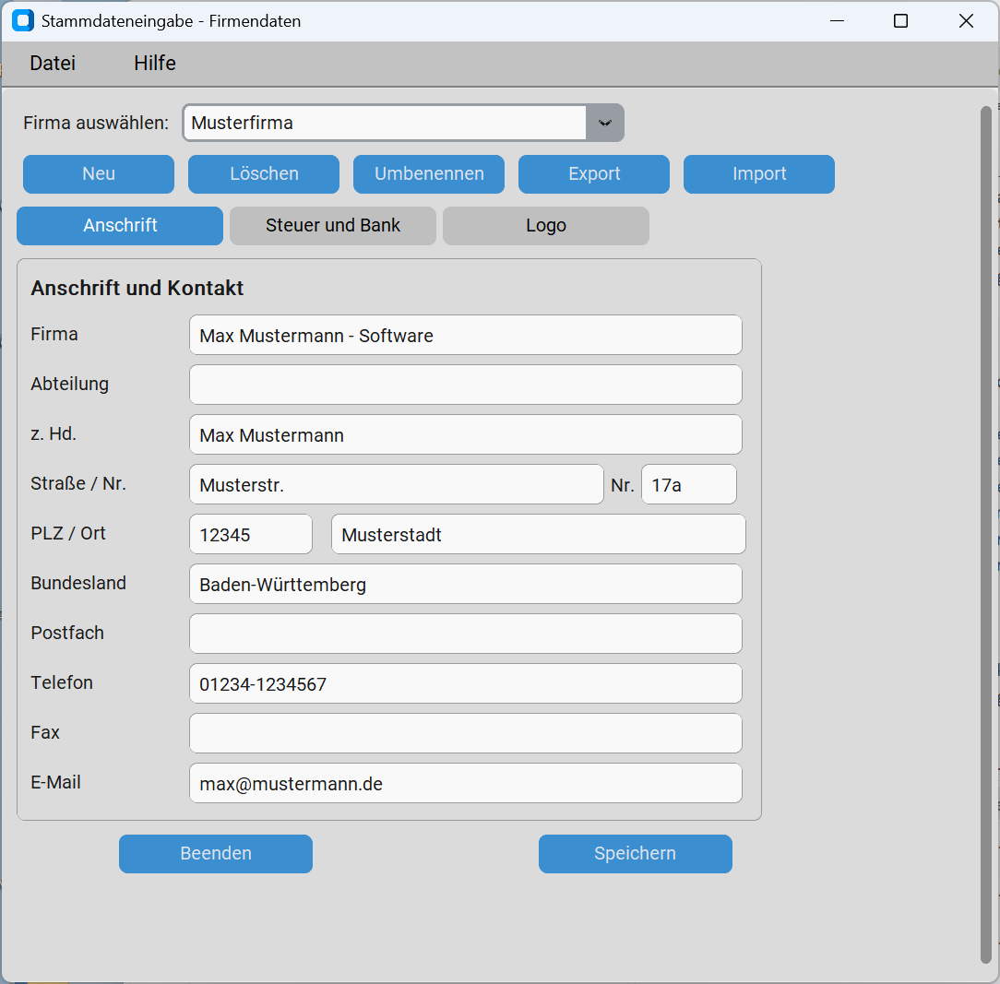
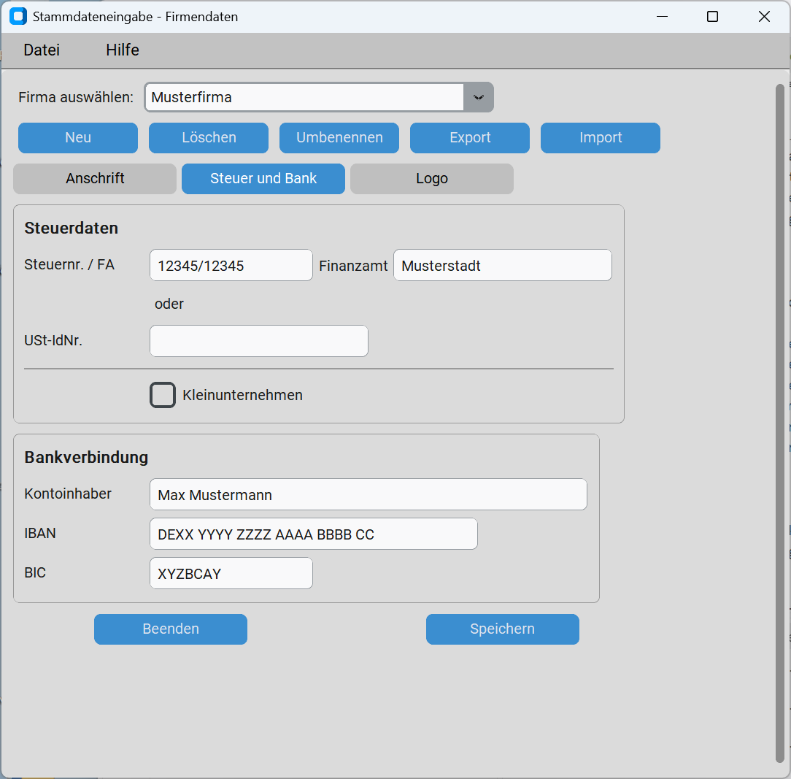
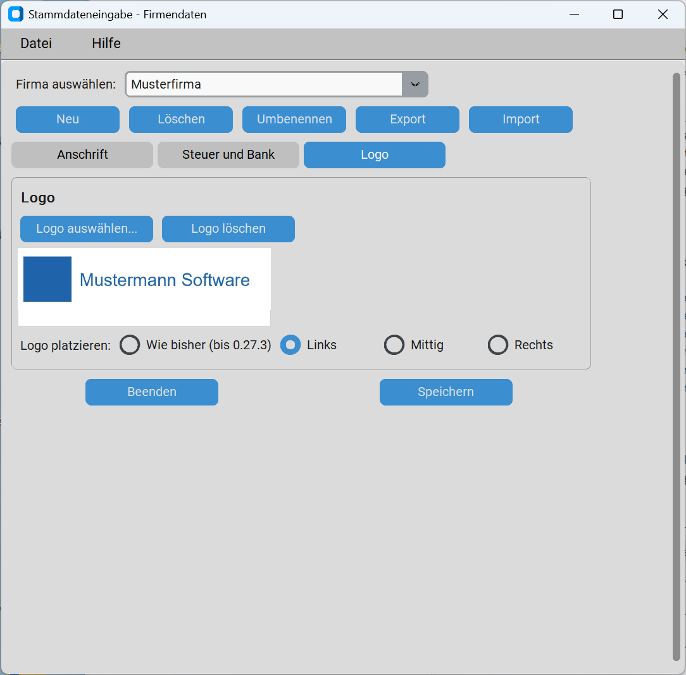
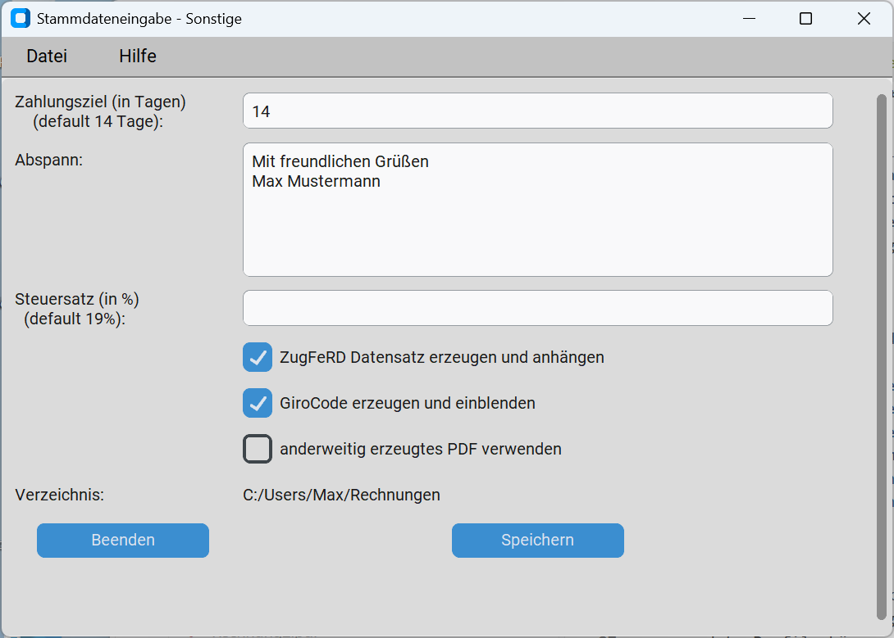
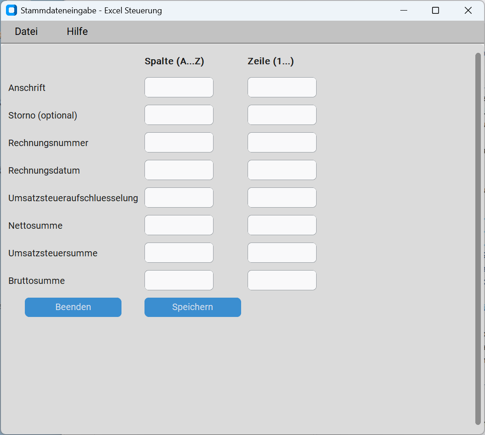
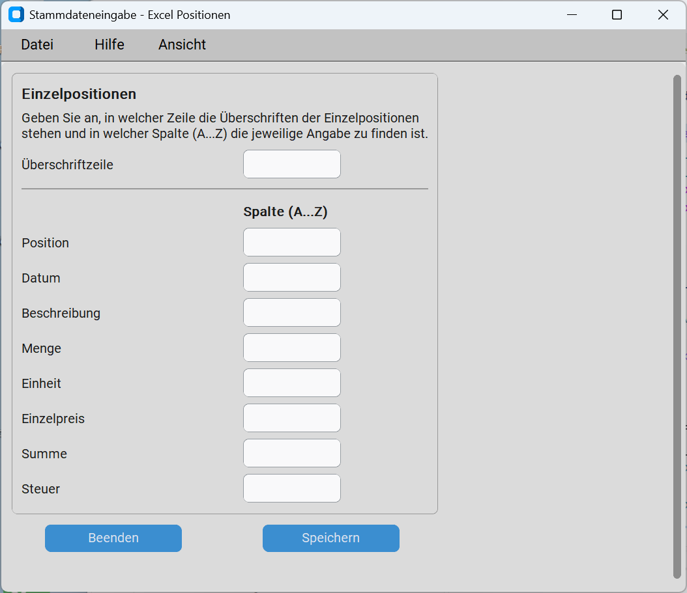
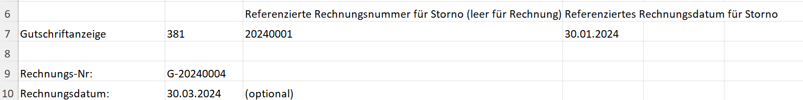
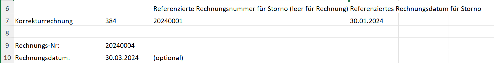
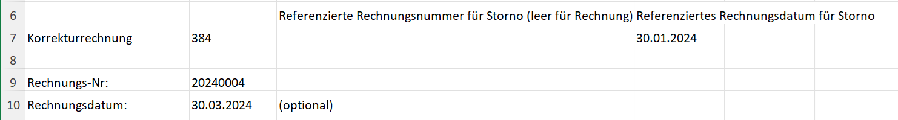

# Excel2ZugFeRD

Dieses Programm liest die Daten aus einer Excel oder LibreOffice Calc Datei aus und hängt sie als ZUGFeRD - kompatible XML-Daten an die neu erstellte Rechnungs-PDF an.

Alternativ kann das Programm den ZugFeRD - Anteil an eine von Ihnen erstellte PDF anhängen. Dann wird die PDF als IhrPdfName_ZuGFeRD.pdf ins Verzeichnis Ihrer PDF gestellt.

> **Kostenlos und Open Source.** Excel2ZUGFeRD hilft Ihnen, die E-Rechnungspflicht ohne Abo-Software zu erfüllen. Wenn es Ihnen Zeit spart, freue ich mich über einen kleinen Beitrag. Er hilft mir, neue Versionen und Formatänderungen zeitnah umzusetzen.
>
> [](https://paypal.me/Lka030)

## Installation

1. Aus dem Release-Verzeichnis in github die neueste Version "setup_excel2zugferd_x6432_VERSION.msi" herunterladen und als Administrator ausführen.
1. Eine Verknüpfung auf die Datei "excel2zugferd.exe" auf dem Desktop wird vom Setup-Programm erstellt.

- Alternativ: In einem Administrator - CMD Fenster `winget install excel2zugferd` ausführen.
- Die Freigabe durch freiwillige Helfer bei WingetCreate findet normalerweise ca. 6 - 12 h nach der neuen Release statt.

Läuft alles? Dann freue ich mich über [eine kleine Unterstützung](https://paypal.me/Lka030). 

Änderungen der einzelnen Versionen stehen in der [CHANGELOG.md](CHANGELOG.md).

## Updates

- Die Vorgehensweise ist Identisch zur Installation.
- Alternativ: In einem Administrator - CMD Fenster `winget update excel2zugferd` ausführen.

 ### Für die Automatisierer:
Das Programm kann auch ohne Oberfläche verwendet werden (nach der Einstellung der Stammdaten):

`"C:\Program Files (x86)\Excel2ZUGFeRD\excel2zugferd.exe" -BlattNr Pfad_zur_Exceldatei.xlsx`

oder

`"C:\Program Files (x86)\Excel2ZUGFeRD\excel2zugferd.exe" -BlattNr Pfad_zur_eigenen_PDF.pdf Pfad_zur_Exceldatei.xlsx`
* Pfad_zur_Exceldatei kann eine .xlsx- oder eine LibreOffice-.ods-Datei sein
* BlattNr 0..n: 0 ist das erste Tabellenblatt
* alle Parameter sind als Zeichenketten anzugeben.

- Die Anwendung schreibt Meldungen in die Windows Ereignisanzeige unter 'Windows-Protokolle' -> 'Anwendung' mit der Quelle 'Excel2ZUGFeRD'
- Fehler werden dort als 'Fehler' ausgegeben und das Programm mit exit Code -1 beendet; bitte die Details ansehen
- bei fehlerfreiem Durchlauf wird die Erfolgsmeldung als 'Informationen' ausgegeben und das Programm mit exit Code 0 beendet

## Programmablauf

Nach dem Start des Programms:

* Wenn keine Ini-Datei vorhanden ist, erstelle sie mit Hilfe der Oberfläche.
    * Sie enthält die Stammdaten des Rechnungserstellers
    * Die Datei "config.ini" steht im Verzeichnis "C:\Benutzer\BENUTZERNAME\AppData\Roaming\excel2zugferd".
* Wenn die Ini-Datei vorhanden ist, lies sie ein.
* Lasse eine Excel-Datei auswählen und lies die Namen der darin vorhandenen Tabellenblätter aus.
* Stelle die Tabellenblätter-Namen als Liste dar und lasse ein Tabellenblatt daraus auswählen.
* Lies die Daten des ausgewählten Tabellenblattes ein und erstelle daraus ein PDF.
* Hänge an das PDF das ZugFeRD Konstrukt im XML-Format an.
* Speichere die Datei als Tabellenblatt-Name.pdf im Verzeichnis der ausgewählten Excel-Datei.

### Stammdateneingabe
Die Firmendaten sind auf drei Reiter verteilt: Anschrift, Steuer und Bank sowie Logo.








### Mehrere Firmenprofile

In der Stammdateneingabe können mehrere Rechnungsaussteller als Firmenprofile
verwaltet werden. Das ausgewählte Profil wird für die Rechnungserstellung
verwendet. Profile können neu angelegt, umbenannt oder gelöscht werden.

Ein einzelnes Firmenprofil lässt sich als JSON-Datei exportieren und auf einer
anderen Installation wieder importieren. Bei einem bereits vorhandenen
Profilnamen erzeugt der Import automatisch einen eindeutigen Namen. Globale
Einstellungen, beispielsweise das Arbeitsverzeichnis und die Excel-Steuerung,
werden nicht exportiert.

Die exportierte Datei enthält sensible Firmen-, Bank- und Steuerdaten und sollte
dementsprechend geschützt aufbewahrt und übertragen werden.

### Excel-Datei
Die Struktur der Excel Datei ist vorgegeben und kann nicht verändert werden, ohne die Funktion zu verlieren.
Als Vorlage benutzen Sie bitte die Datei "TestRechnung.xlsx". Alternativ können auch LibreOffice-Dateien (.ods) verwendet werden, z.B. "TestRechnung.ods".

Alternativ können Sie die XY-Positionen im Excel Blatt (Spalten: A...Z, Zeilen: 1...) in den Stammdaten "Excel Steuerung" und "Excel Positionen" angeben.
Damit können die XY-Positionen verändert werden und die Suchfunktion wird abgeschaltet. Durch die Angabe der "Excel Positionen" können Sie auch die Überschriften der Einzelpositionen anpassen z.B: Pos. -> Nr., Typ -> EH usw..

#### Einheiten
Die verwendbaren Einheiten in der Spalte 'Typ' sind:
* 'h': Stunden,
* 'min': Minuten,
* 'Tag(e)': Tage,
* 'Monat(e)': Monate,
* 'Jahr(e)': Jahre,
* 'l': Liter,
* 'Liter': Liter,
* 'kg': Kilogramm,
* 't': Tonne,
* 'm': Meter,
* 'm²': Quadratmeter,
* 'm³': Kubikmeter,
* '1': Stück,
* 'Stk.': Stück,
* 'kWh': Kilowattstunden
* 'AW' : Arbeitswerte (service unit);
* der Default liefert Stück und dokumentiert in der Beschreibung (BT-154): "Die Einheit 'NIX' ist nicht verfügbar und wurde durch 'C62' (Stück) ersetzt."

Sollten Sie weitere Einheiten benötigen, schreiben Sie gerne einen „Issue“.

#### Mehrere Steuersätze

In der Excel-Datei TestRechnung.xlsx ist im Tabellenblatt "Rechnung div. Steuern" ein Beispiel für die Verwendung verschiedener Steuersätze in einer Rechnung.

Die zweistufige Ausführung über Steuer 1..n und danach eine Umsatzsteueraufschlüsselung in der die Steuersätze stehen, ist dem Umstand geschuldet, dass es verschiedene Ausnahmebegründungen für einen Steuersatz von 0.00% geben kann. Da die Umsatzsteuersumme bei Steuersatz 0.00% immer 0.00 € ergibt, habe ich da die jeweilige Ausnahmebegründung hinterlegt. Ich prüfe dabei nicht ab, ob der Eintrag sinnvoll ist. Das macht dann das Finanzamt 😊.

Leider ist in der Spezifikation vorgesehen, dass nur eine ApplicableTradeTax mit CategoryType E im Header eingetragen werden darf. Bei der Prüfung der XML Daten geht ein aktuelles Prüfprogramm so vor, dass die Nettosummen aller Einzelpositionen mit ApplicableTradeTax, Category E und identischem ExceptionReason mit dem BasisAmount der ApplicableTradeTax, Category E und identischem ExceptionReason im Header verglichen wird. Bei Abweichung > 0.1% gibt es eine Warnung. Um das zu verhindern und trotzdem eine Unterscheidbarkeit der ExceptionReasons herbeizuführen, habe ich die ExceptionReasons so aufgebaut, dass:
```Pos. x-y, n: ExceptionReason1 (Netto Summe1 EUR); Pos. z: ExceptionReason2 (Netto Summe2 EUR)```
als kombinierte ExceptionReason verwendet wird. Die Nettosummen werden addiert und in den BasisAmount im Header geschrieben (Die Addition ergibt "hoffentlich" keine Rundungsfehler.).
Die Struktur ```Steuer, Steuersatz (in %), Nettosumme, Steuersumme oder ExceptionReason wenn Steuer = 0.00%``` für die Umsatzsteueraufschlüsselung ist vorgegeben. Wenn eine Nettosumme 0,00 € enthält, wird diese Zeile nicht berücksichtigt.

#### Positionsweise "Gutschriften"

Innerhalb einer Handelsrechnung können positionsweise "Gutschriften" erstellt werden, indem die Summe und die darauf erhobene Steuer berücksichtigt wird. Die XML Struktur erlaubt allerdings nur positive Einzelpreise. Das bedeutet, wenn in der Rechnung für eine Position die Menge negativ eingetragen wird, funktioniert das und wird auch als korrekt validiert.

#### Gutschriftanzeige / Stornorechnung oder Korrekturrechnung

Um eine Gutschriftanzeige oder Korrekturrechnung zu erzeugen, wird im Excel-Sheet eine Zeile mit 4 Feldern hinterlegt:
```
Feld 1 = Gutschriftanzeige (oder Korrekturrechnung); Das ist der Text, der dann im PDF statt Rechnungs-Nr. steht.
Feld 2 = 381 (oder 384 falls es eine Korrekturrechnung sein soll); Das ist der Typ, der im XML eingetragen wird.
Feld 3 = Rechnungsnummer der zu stornierenden Rechnung (händisch eintragen)
Feld 4 = Rechnungsdatum der zu stornierenden Rechnung (händisch eintragen)
```



In der neuen Rechnungsnummer steht dann die Gutschriftsnummer, also z.b. G-2024004 (oder die neue Rechnungsnummer z.B. 20240004, wenn es eine Korrekturrechnung sein soll).

Eine Korrekturrechnung ersetzt die alte Rechnung.



Die Funktion wird ausgeschaltet, wenn Feld 3 (die Rechnungsnummer) leer ist, dann funktioniert alles wie gehabt und eine Rechnung wird erzeugt.



Die Position der 4 Felder kann auch über die Excel-Steuerung in den Feldern Storno vorgegeben werden, die Reihenfolge ist aber fest vorgegeben. Hier wäre es Zeile 7 Spalte A.

Siehe Vorlagen "Gutschriftanzeige", "Gutschriftanzeige negativ" und "Korrekturrechnung" in "TestRechnung.xlsx"

Die Spezifikation für eine Gutschriftanzeige enthält folgenden Satz: "Nicht möglich (gemäß der semantischen Norm) sind hingegen negative Gutschriften, also Gutschriften, deren Betrag inkl. Steuern negativ ist."
Ich habe Typ 381 Gutschriftanzeige bewusst so gestaltet, dass er das nicht beachtet, denn eigentlich erstelle ich damit eine Negativrechnung. Der Validator aktzeptiert das als korrekt. Sie sollten das also mit dem Empfänger der Gutschriftanzeige vorab klären.

## Copyright and License

Copyright [2024] [Herbert Lischka]
[](https://opensource.org/licenses/Apache-2.0)

   Licensed under the Apache License, Version 2.0 (the "License");
   you may not use this file except in compliance with the License.
   You may obtain a copy of the License at

       http://www.apache.org/licenses/LICENSE-2.0

   Unless required by applicable law or agreed to in writing, software
   distributed under the License is distributed on an "AS IS" BASIS,
   WITHOUT WARRANTIES OR CONDITIONS OF ANY KIND, either express or implied.
   See the License for the specific language governing permissions and
   limitations under the License.
